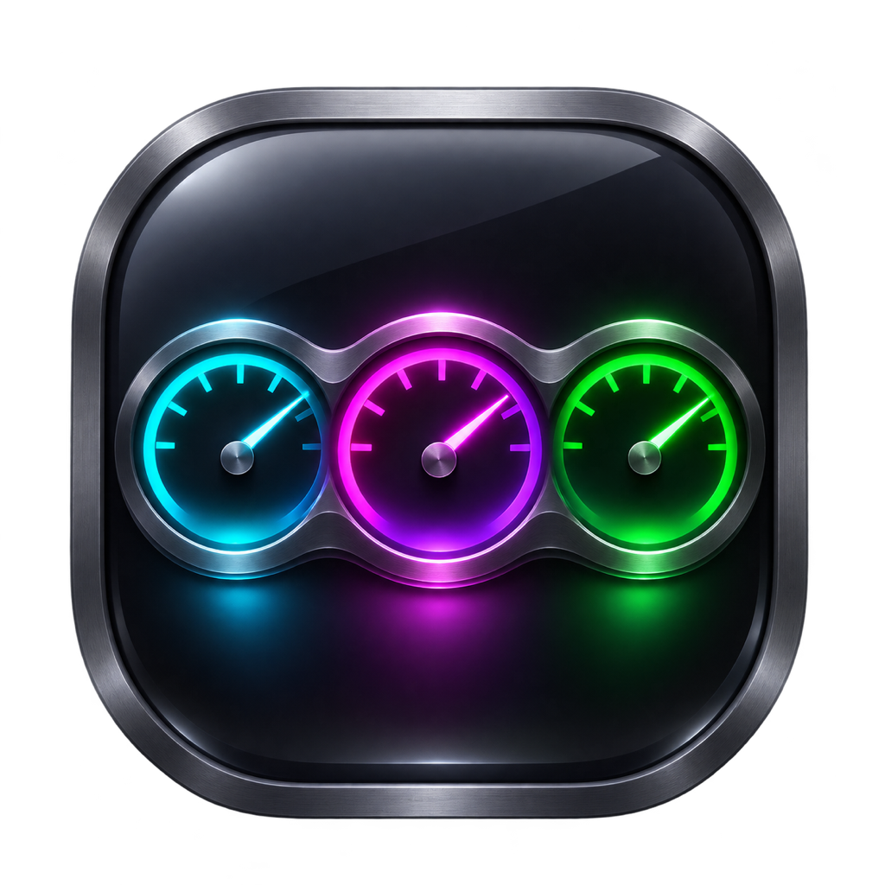
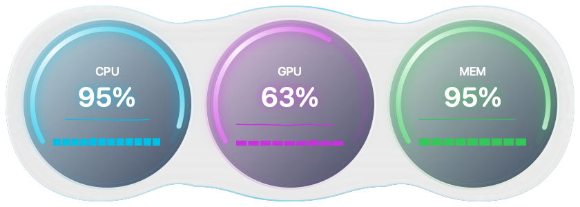
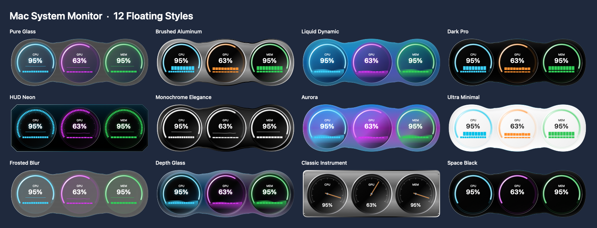

<p align="center"></p>

<h1 align="center">HUD Systemo Monitor</h1>
<p align="center"><strong>Macの鼓動を、眺めたくなる計器に。</strong></p>
<p align="center">3連メーター · 12スタイル · macOSネイティブ</p>
<p align="center"><a href="README.md">English</a> · 日本語 · <a href="README.zh-Hant.md">繁體中文</a></p>

[**DMGをダウンロード →**](https://github.com/Hamzimer/Mac-Systemo-Monitor/releases/latest) · [不具合を報告](https://github.com/Hamzimer/Mac-Systemo-Monitor/issues)



*アプリのSwiftUI画面を実測値で描画したプレビューです。デスクトップのスクリーンショットではありません。数値はMacの状態によって変わります。*

## 性能を、デスクトップの風景に

CPU・GPU・メモリを、つながった3つの丸い計器で表示します。透明なガラス、精密な金属、鮮やかなネオン。気分に合わせた素材でMacの動きを確認し、作業に集中するときはメニューバーへ収められます。

- **12種類のスタイル。** ガラスからアナログ計器まで、同じ実測データを異なる表現で楽しめます。
- **メーターだけが浮かぶ形。** 外側は透明。本体のドラッグで移動、右下のハンドルでサイズ変更できます。
- **CPUコアの動きが見える。** 全体使用率と各論理コアの負荷を表示します。
- **GPUを実測。** 取得できる環境では全体・描画・タイル処理の使用率を表示し、未取得は「—」で示します。
- **メモリを詳しく。** 使用量・総容量・アプリ・固定・圧縮・キャッシュ・スワップを確認できます。
- **メニューバーでも継続。** ⌘MでCPU・GPU・メモリの数値と小さなグラフに切り替わります。
- **ネイティブでローカル。** SwiftUIとAppKitで実装。外部ランタイムやアカウントは不要で、計測値を外部へ送信しません。

## 12の表情



*実装済み画面の描画一覧です。コンセプト画像ではありません。アニメーション対応スタイルは実行中に動きます。*

| スタイル | 表現 |
| --- | --- |
| Pure Glass | 軽やかにつながる透明なガラス |
| Brushed Aluminum | 金属の質感と精密なリング |
| Liquid Dynamic | 青いフレームと流れる液体 |
| Dark Pro | 落ち着いた暗い素材と明快な表示 |
| HUD Neon | セグメントゲージと角のあるフレーム |
| Monochrome Elegance | シルバーと黒の計器 |
| Aurora | 青・紫・緑の光と動く波 |
| Ultra Minimal | 白いフレームと必要な情報 |
| Frosted Blur | 柔らかい半透明の素材 |
| Depth Glass | 重なる反射と光の奥行き |
| Classic Instrument | アナログ針・金属・ネジ |
| Space Black | 深い黒と光の輪郭 |

## インストール

**Apple Silicon搭載Mac・macOS 14以降**に対応します。このビルドはIntel Macには対応していません。

1. [Releases](https://github.com/Hamzimer/Mac-Systemo-Monitor/releases/latest)から`HUD-Systemo-Monitor.dmg`をダウンロードします。
2. 旧版を⌘Qで終了し、DMGを開いて **HUD Systemo Monitor.app** を **Applications** へドラッグします。
3. コピー先のアプリを開きます。

現在のビルドはアドホック署名です。**Developer ID署名・公証は未対応**のため、ダウンロードしたアプリはmacOSでブロックされる場合があります。ソースからのローカルビルドも利用できます。リリースには整合性確認用の`SHA256SUMS.txt`を添付します。

## 操作

| したいこと | 操作 |
| --- | --- |
| 移動 | メーター本体をドラッグ |
| サイズ変更 | MEM右下の斜線ハンドルをドラッグ |
| 別のサイズ変更方法 | Option＋スクロール、または右クリックの拡大・縮小 |
| スタイル選択 | 右クリックのスタイルメニュー。選択は自動保存 |
| メニューバーへ最小化 | ⌘M、または右クリックの最小化 |
| 復元 | メニューバーの表示をクリックして「モニターを表示」 |
| 詳細表示 | 右クリックの詳細。CPUコア・GPU処理別・メモリ・SSD・ネットワーク |
| 最前面 | 「表示」メニューの「常に手前に表示」 |
| 終了 | ⌘Q |

アプリのメニューは現在日本語です。説明文書は英語・日本語・繁体中国語を用意していますが、アプリ自体の多言語切り替えは本リリースに含まれていません。

## 計測値について

| 項目 | 対応 | 制約 |
| --- | --- | --- |
| CPU | 全体と各論理コアの使用率 | 物理コア構成の表示ではありません |
| GPU | 全体・描画・タイル処理、取得可能ならハードウェアのコア数 | **物理GPUコア別の使用率は取得できません**。推定コア負荷を実測として表示しません |
| メモリ | 使用量・総容量・アプリ・固定・圧縮・キャッシュ・スワップ | 他のシステムツールと分類が異なる場合があります |
| ストレージ | 詳細画面で容量・使用量 | ホームフォルダのあるボリュームの統計 |
| ネットワーク | 詳細画面でインターフェース合計の送受信速度 | 仮想・VPNインターフェースにより重複集計の可能性があります |

更新は**1秒周期**、履歴は**各項目最大60サンプル**です。CPU下の棒は各論理コアの現在値、GPU・メモリの棒は直近の履歴です。

Liquid Dynamic・Aurora・Depth Glassでは、使用率に応じた高さで装飾の波が動きます。最小化・アプリ非表示中は波の定期描画を停止し、macOSの「視差効果を減らす」にも対応します。メニューバー用の計測は続きます。

GPUのカウンターは機種とmacOSに依存し、取得できない場合があります。温度・ファン回転数・周波数は未実装です。履歴上限と非表示時の描画停止は負荷を抑える設計ですが、アプリ全体の最小メモリ使用量を保証するものではありません。

## ソースからビルド

Xcodeとコマンドラインツールを用意し、Apple Silicon Macで実行します。

```sh
bash build.sh ./build
open "build/HUD Systemo Monitor.app"
```

ウィジェットを起動せず、センサーの実測値を3回出力するには次を実行します。

```sh
"build/HUD Systemo Monitor.app/Contents/MacOS/HUDSystemoMonitor" --sample
```

Swiftは5ファイルです。計測、上限付き履歴モデル、共通の計器描画、ウィンドウとメニュー、起動処理を分けています。ローカルビルドにはアドホック署名を付けます。

## 検証・フィードバック

**M2 Max・メモリ32GBのMac**でビルドとCPU・GPU・メモリの実測を確認しました。12スタイルの描画・外周の透明度は別途確認済みです。ネイティブメニュー項目の保持、サイズ変更の座標計算、ハンドルのヒット判定には同梱の自動チェックを利用できます。

```sh
bash tests/run.sh
```

これらは実際のマウス操作を再現するテストではありません。制限付き開発環境のため、デスクトップ上での連続ドラッグ・メニュー選択・最小化と復元・Dockアイコン表示の手動確認は未完了です。GUI全体のメモリ使用量も未計測です。

改善案や対応機種の情報は[Issue](https://github.com/Hamzimer/Mac-Systemo-Monitor/issues)へ。Macの機種、macOS、アプリのバージョン、再現手順をご記載ください。画像やログに個人情報が入っていないか確認してください。

**気に入っていただけたら、Starで応援していただけるとうれしいです。ほかのMacユーザーが見つけるきっかけになります。**

## License

[MIT](LICENSE) · Copyright © 2026 Hamzimer.
