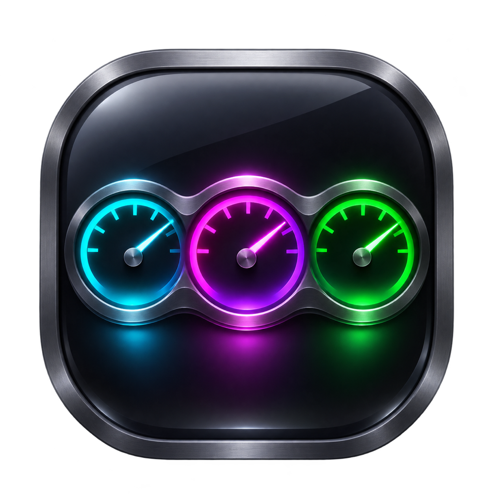
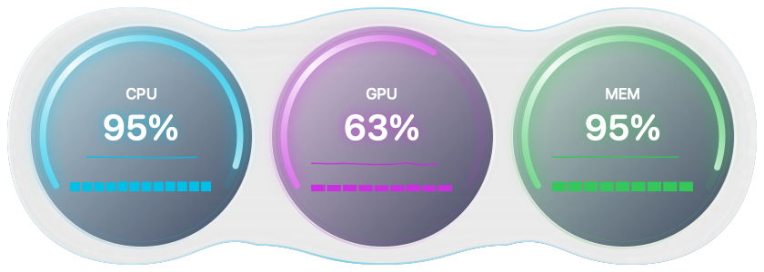
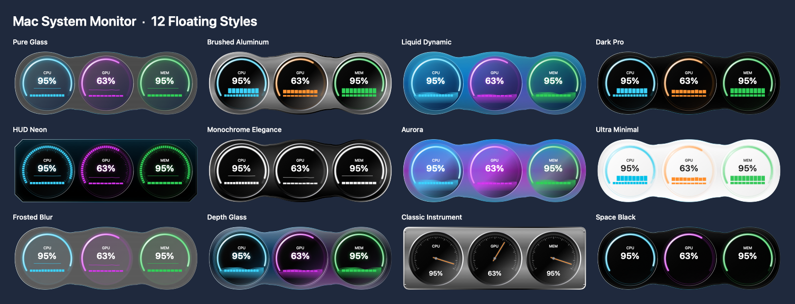

<p align="center"></p>

<h1 align="center">HUD Systemo Monitor</h1>
<p align="center"><strong>Your Mac’s performance, in an instrument worth looking at.</strong></p>
<p align="center">Three connected gauges · 12 visual styles · A native macOS widget</p>
<p align="center">English · <a href="README.ja.md">日本語</a> · <a href="README.zh-Hant.md">繁體中文</a></p>


[**Download the DMG →**](https://github.com/Hamzimer/Mac-Systemo-Monitor/releases/latest) · [Report an issue](https://github.com/Hamzimer/Mac-Systemo-Monitor/issues)



*Interface preview rendered from the app’s SwiftUI views using measured telemetry. This is not a desktop screenshot; readings vary with your Mac.*

## Make performance visible

CPU, GPU and memory share one floating instrument cluster. Follow live activity in three circular gauges, choose a material that fits your desktop, and tuck the monitor into the menu bar when you need the space.

- **12 looks, one monitor.** Glass, aluminum, neon, monochrome and analog instruments share the same live data.
- **A floating shape.** The area outside the gauges is transparent. Drag the instrument to move it; use the lower-right grip to resize it.
- **Live CPU detail.** See overall CPU use and activity for each logical CPU core.
- **Honest GPU readings.** Device, renderer and tiler utilization where available. Unsupported values show “—”.
- **Useful memory detail.** Used and total RAM, application memory, wired memory, compression, cache and swap.
- **A compact menu-bar view.** Minimize with ⌘M to keep CPU, GPU and memory percentages and mini graphs within reach.
- **Native and local.** SwiftUI + AppKit, no third-party runtime dependencies, no account and no telemetry uploads.

## Find your style



*Rendered UI previews, not concept artwork. Animated styles move in the running app.*

| Style | Character |
| --- | --- |
| Pure Glass | Light, connected glass |
| Brushed Aluminum | Metal finish and precise rings |
| Liquid Dynamic | Flowing liquid inside a blue frame |
| Dark Pro | Quiet dark surfaces and bright indicators |
| HUD Neon | Segmented gauges and angular framing |
| Monochrome Elegance | Silver and black instruments |
| Aurora | Blue, purple and green light with moving waves |
| Ultra Minimal | A white frame and clear essentials |
| Frosted Blur | Soft, translucent material |
| Depth Glass | Layered reflections and luminous depth |
| Classic Instrument | Analog needles, metal and screws |
| Space Black | Deep black with illuminated contours |

## Install

Requires **Apple Silicon and macOS 14 or later**. Intel Macs are not supported by this build.

1. Download `HUD-Systemo-Monitor.dmg` from [Releases](https://github.com/Hamzimer/Mac-Systemo-Monitor/releases/latest).
2. Quit any older copy with ⌘Q, open the DMG and drag **HUD Systemo Monitor.app** into **Applications**.
3. Open the copied app.

The current build is ad-hoc signed, **not Developer ID signed or notarized**. macOS may block a downloaded copy. Building locally is an alternative. The release includes `SHA256SUMS.txt` for file-integrity checks.

## Controls

| Action | Control |
| --- | --- |
| Move | Drag the body of the gauges |
| Resize | Drag the diagonal grip at the lower-right of MEM |
| Alternative resizing | Option + scroll, or right-click → smaller / larger |
| Choose a style | Right-click → style submenu; selection is saved |
| Menu-bar mode | ⌘M or right-click → minimize to menu bar |
| Restore | Click the menu-bar readout → show monitor |
| More detail | Right-click → details; CPU cores, GPU engines, RAM, storage and network |
| Keep on top | View menu → always on top |
| Quit | ⌘Q |

**UI languages:** 日本語 / English / 繁體中文. Right-click the widget → Language, or use View → Language. Follow System is also available. Changes apply without restarting and are saved for the next launch. Menus, detail labels, tooltips and accessibility hints are translated; CPU/GPU/MEM and style names remain shared identifiers.

## What the data means

| Metric | Available | Limit |
| --- | --- | --- |
| CPU | Total use and per-logical-core activity | Logical cores, not a claim of physical-core topology |
| GPU | Device, renderer and tiler utilization; hardware core count where readable | **Physical GPU per-core utilization is unavailable**; no estimated core activity is fabricated |
| Memory | Use, total, application, wired, compressed, cache and swap | Different system tools may categorize memory differently |
| Storage | Capacity and used space in the details view | Home-volume filesystem statistics |
| Network | Interface-aggregated receive/send rate in the details view | Virtual/VPN interfaces can cause double counting |

Metrics refresh every **1 second**. History is capped at **60 samples per metric**. CPU bars represent current logical-core use; GPU and memory bars represent recent history.

Liquid Dynamic, Aurora and Depth Glass add decorative wave motion whose level follows utilization. These animations pause when the widget is minimized or the app is hidden. Reduce Motion is respected. Menu-bar measurements continue while minimized.

GPU counters depend on hardware and macOS availability. Temperature, fan speed and clock frequency are not implemented. There is no claim of minimum full-app RAM usage; bounded history and paused hidden animations are implementation choices, not a benchmark.

## Build from source

Install Xcode with its command-line tools, then run on an Apple Silicon Mac:

```sh
bash build.sh ./build
open "build/HUD Systemo Monitor.app"
```

For a three-sample sensor check without launching the widget:

```sh
"build/HUD Systemo Monitor.app/Contents/MacOS/HUDSystemoMonitor" --sample
```

The six Swift files separate sensor acquisition, the bounded-history model, shared gauge rendering, AppKit window/menu behavior, localization and the entry point. Build output is ad-hoc signed locally.

## Verification and contributions

The app was built and its CPU, GPU and memory readings sampled on an **M2 Max Mac with 32 GB RAM**. Previous rendering checks covered all 12 styles and transparent outer pixels. Native menu-object stability, resize geometry and grip hit testing have automated checks included here:

```sh
bash tests/run.sh
```

Checks now also deliver mouse-down, drag and mouse-up events through NSWindow to verify body movement and grip resizing while metrics update. Language-menu actions, persistence and all translation keys are checked. These synthetic events do not replace physical mouse testing. Manual desktop verification of resizing, menu selection, minimize/restore and Dock icon appearance remains outstanding in the restricted development environment. Full GUI memory usage has not been benchmarked.

Have a visual refinement or a hardware compatibility report? [Open an issue](https://github.com/Hamzimer/Mac-Systemo-Monitor/issues) with your Mac model, macOS version, app version and steps to reproduce. Remove personal information from any screenshots or logs.

**If this makes your desktop more useful, a star helps other Mac users discover it.**

## License

[MIT](LICENSE) · Copyright © 2026 Hamzimer.
