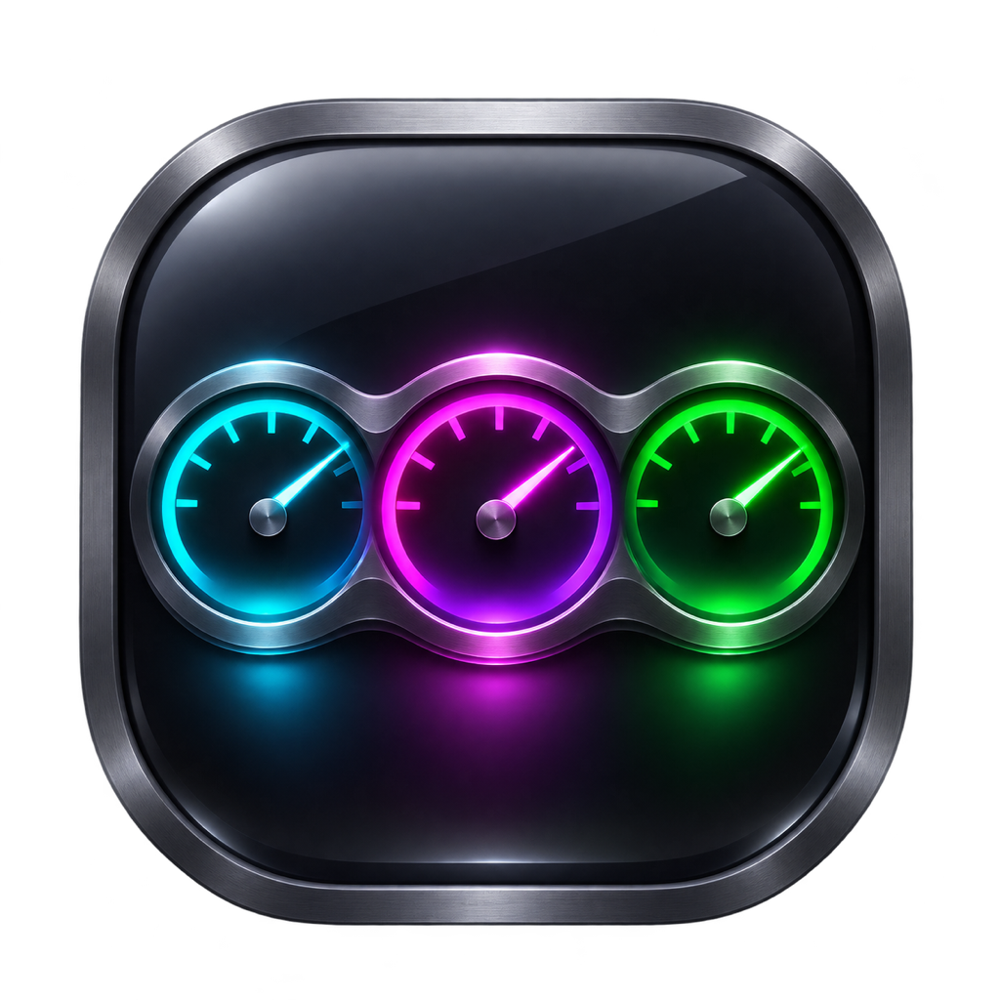
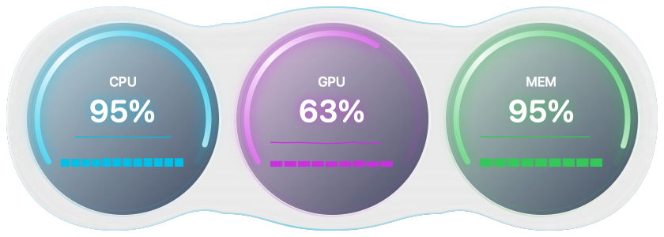
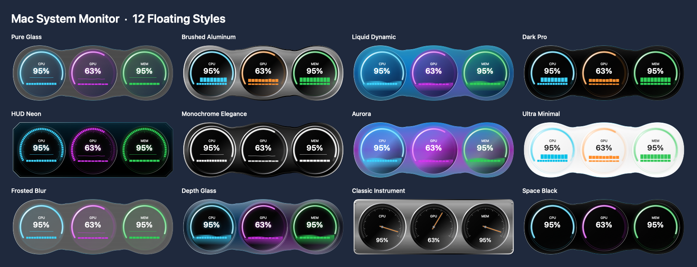

<p align="center"></p>

<h1 align="center">HUD Systemo Monitor</h1>
<p align="center"><strong>讓 Mac 的效能，成為值得欣賞的儀表。</strong></p>
<p align="center">三連圓形儀表 · 12 種風格 · macOS 原生應用程式</p>
<p align="center"><a href="README.md">English</a> · <a href="README.ja.md">日本語</a> · 繁體中文</p>

[**下載 DMG →**](https://github.com/Hamzimer/Mac-Systemo-Monitor/releases/latest) · [回報問題](https://github.com/Hamzimer/Mac-Systemo-Monitor/issues)



*以應用程式的 SwiftUI 畫面及實測資料繪製的介面預覽，並非桌面螢幕截圖。數值會隨 Mac 的狀態而變動。*

## 讓效能成為桌面風景

將 CPU、GPU 與記憶體整合為一組懸浮儀表。選擇適合桌面的玻璃、金屬或霓虹材質，隨時掌握即時活動；需要更多工作空間時，還能縮小至選單列。

- **12 種風格，同一份即時資料。** 從通透玻璃到經典指針，依心情切換。
- **只有儀表，懸浮桌面。** 外圍透明；拖曳本體即可移動，右下角握柄可調整大小。
- **看見 CPU 核心活動。** 顯示整體使用率與各邏輯核心的負載。
- **呈現可取得的 GPU 實測值。** 支援整體、算繪與分塊處理使用率；無法取得的數值顯示「—」。
- **記憶體細節一目了然。** 已用與總容量、應用程式、固定、壓縮、快取及交換空間。
- **選單列持續監測。** 按 ⌘M，切換為 CPU、GPU 與記憶體的百分比及迷你圖表。
- **原生、本機運作。** 使用 SwiftUI 與 AppKit，無第三方執行環境、無須帳號，也不會上傳監測資料。

## 找到你的風格



*這些是實際介面的繪製預覽，並非概念設計圖。支援動畫的風格會在執行時動起來。*

| 風格 | 特色 |
| --- | --- |
| Pure Glass | 輕盈相連的透明玻璃 |
| Brushed Aluminum | 金屬質感與精細圓環 |
| Liquid Dynamic | 藍色框架中的流動液體 |
| Dark Pro | 沉穩深色材質與鮮明指示 |
| HUD Neon | 分段儀表與俐落框架 |
| Monochrome Elegance | 銀黑色調的精緻儀表 |
| Aurora | 藍、紫、綠光與流動波紋 |
| Ultra Minimal | 白色框架與必要資訊 |
| Frosted Blur | 柔和的半透明材質 |
| Depth Glass | 層疊反射與光的深度 |
| Classic Instrument | 指針、金屬與螺絲細節 |
| Space Black | 深黑底色與發光輪廓 |

## 安裝

需要 **Apple Silicon Mac 與 macOS 14 或更新版本**。此版本不支援 Intel Mac。

1. 從 [Releases](https://github.com/Hamzimer/Mac-Systemo-Monitor/releases/latest) 下載 `HUD-Systemo-Monitor.dmg`。
2. 先以 ⌘Q 結束舊版，開啟 DMG，將 **HUD Systemo Monitor.app** 拖入 **Applications**。
3. 開啟複製後的應用程式。

目前採用臨時簽章，**尚未使用 Developer ID 簽章或完成公證**，因此 macOS 可能阻擋下載的副本。也可以從原始碼在本機建置。發行版本附有 `SHA256SUMS.txt`，可用於檢查檔案完整性。

## 操作

| 功能 | 操作方式 |
| --- | --- |
| 移動 | 拖曳儀表本體 |
| 調整大小 | 拖曳 MEM 右下角的斜線握柄 |
| 其他縮放方式 | Option＋捲動，或右鍵選單的縮小／放大 |
| 選擇風格 | 右鍵開啟風格子選單；選擇會自動儲存 |
| 縮小至選單列 | ⌘M，或右鍵選單的最小化功能 |
| 還原 | 點選選單列的讀數，再選擇顯示監視器 |
| 詳細資訊 | 右鍵開啟詳細視窗，查看 CPU 核心、GPU 處理、記憶體、儲存空間及網路 |
| 保持最上層 | 「顯示」選單中的置頂功能 |
| 結束 | ⌘Q |

**介面語言：日本語 / English / 繁體中文。** 在儀表按右鍵→「顯示語言」，或從「顯示」→「顯示語言」選取。亦可跟隨系統設定。切換後立即生效，無須重新啟動，並會記住設定。選單、詳細資訊、提示與輔助使用說明皆已翻譯；CPU/GPU/MEM 與風格名稱維持共通識別。

## 資料與限制

| 項目 | 可取得的資訊 | 限制 |
| --- | --- | --- |
| CPU | 整體及各邏輯核心使用率 | 並非實體核心拓樸顯示 |
| GPU | 整體、算繪、分塊處理使用率；可讀取時顯示硬體核心數 | **無法取得各實體 GPU 核心的使用率**，不會以推估活動冒充實測 |
| 記憶體 | 已用、總容量、應用程式、固定、壓縮、快取與交換空間 | 分類可能與其他系統工具不同 |
| 儲存空間 | 詳細視窗中的容量及已用空間 | 使用個人資料夾所在卷宗的檔案系統統計 |
| 網路 | 詳細視窗中的介面合計收發速率 | 虛擬或 VPN 介面可能造成重複計算 |

數值每 **1 秒**更新，每個項目最多保留 **60 筆歷史資料**。CPU 下方的直條代表各邏輯核心目前的使用率；GPU 與記憶體的直條代表近期歷史資料。

Liquid Dynamic、Aurora 與 Depth Glass 提供裝飾性波紋動畫，波紋高度會隨使用率變化。縮小或隱藏應用程式時，波紋停止定期繪製；也支援 macOS 的「減少動態效果」。縮小期間仍會持續更新選單列的監測資料。

GPU 計數器是否可用取決於機型與 macOS。溫度、風扇轉速及時脈尚未實作。限制歷史資料長度與暫停隱藏動畫是降低負載的設計，並不代表已達到最低整體記憶體用量。

## 從原始碼建置

安裝 Xcode 與命令列工具後，在 Apple Silicon Mac 上執行：

```sh
bash build.sh ./build
open "build/HUD Systemo Monitor.app"
```

若只想取得三次感測讀數而不開啟儀表：

```sh
"build/HUD Systemo Monitor.app/Contents/MacOS/HUDSystemoMonitor" --sample
```

六個 Swift 檔案分別處理資料取得、有限長度的歷史模型、共用儀表繪製、視窗與選單、翻譯及啟動流程。本機建置會加上臨時簽章。

## 驗證與參與

已在 **M2 Max、32 GB 記憶體的 Mac** 上建置並讀取 CPU、GPU 與記憶體實測值，另已檢查全部 12 種風格的繪製及外圍透明度。隨附的自動檢查涵蓋原生選單項目的穩定性、縮放座標計算與握柄點擊判定：

```sh
bash tests/run.sh
```

檢查會透過 NSWindow 傳送滑鼠按下、拖曳及放開事件，驗證資料更新時的移動與握柄縮放，並檢查語言選單、設定保存與所有翻譯鍵。這些模擬事件無法取代實體滑鼠操作測試。受限於開發環境，桌面上的連續拖曳、選單選取、縮小與還原，以及 Dock 圖示外觀，尚未完成手動驗證；整體 GUI 記憶體用量也尚未測量。

歡迎透過 [Issue](https://github.com/Hamzimer/Mac-Systemo-Monitor/issues) 提出視覺改進或硬體相容性回報。請提供 Mac 機型、macOS 版本、應用程式版本與重現步驟，並先移除截圖或記錄中的個人資訊。

**如果這款儀表讓你的桌面更實用，歡迎給一顆 Star，讓更多 Mac 使用者發現它。**

## License

[MIT](LICENSE) · Copyright © 2026 Hamzimer.
